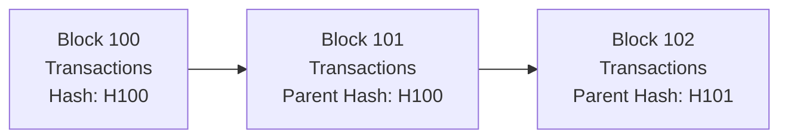

# Blockchain, Explained: How It Works and Where It Matters

Internship Research Report
Repository: Skillzeno-Internship-Tasks

The main idea: Blockchain is more than cryptocurrency.   
It is a way for multiple participants to maintain and verify a shared record using common rules instead of relying entirely on one central record-keeper.

What this report covers
1. Research the fundamentals of blockchain technology.
2. Learn about blocks, transactions, and distributed ledgers.
3. Understand how blockchain networks work.
4. Study real-world blockchain applications.
   --
   
1. Blockchain Fundamentals: A Shared Record, Not Magic
Imagine a product moving from a manufacturer to a delivery company, a distributor, and finally a store. Each organization keeps its own spreadsheet. If the shipment date or quantity differs between records, the organizations need to work out which version to trust.
A blockchain offers a different approach: participants follow shared rules to record and verify updates in a common ledger. Copies of the ledger are maintained by participating computers, and cryptographic techniques help make unauthorized changes detectable. Instead of asking only “Whose database should we trust?”, participants can also ask “Does this update follow the network's rules?”
A blockchain typically combines five building blocks:
- Distributed ledger: a shared record maintained by multiple participants.
- Cryptographic hashes: digital fingerprints that help link blocks and detect changes.
- Digital signatures: a way to verify that a transaction was authorized by the relevant key.
- Validation rules: checks that determine whether transactions and blocks are acceptable.
- Consensus or ordering: mechanisms that help the network agree on the accepted sequence of updates.
A distributed ledger is the broader idea; blockchain is one way to implement it. Not every distributed ledger uses blocks linked in a chain, and storing copies of a normal database on multiple servers does not automatically make it a blockchain. What matters is how updates are authorized, verified, ordered, and governed [1][2].
Principles worth remembering
Shared control. Responsibility for maintaining or validating records may be distributed across multiple participants rather than held entirely by one operator. The level of decentralization varies from network to network.
Tamper evidence. Each block commonly refers to an earlier block through a cryptographic hash. If earlier data changes, its hash changes too, making that change detectable. This helps protect the history, but it does not make a system magically impossible to change under every circumstance [3].
Transparency and auditability. Public blockchain activity can often be inspected by anyone. However, seeing an address does not automatically tell you who controls it. Permissioned networks can restrict access to selected participants.
Shared rules. A transaction is accepted because it satisfies the network's rules, not simply because one participant says it should be accepted.
A practical limitation: blockchain can preserve data, but it cannot guarantee that the information entered in the first place is true. If someone records a false delivery status, the ledger may preserve that false report very reliably.

### Public vs. Permissioned Networks

| Network Type | Who Can Participate? | Typical Use |
|---|---|---|
| **Public Network** | Generally open to anyone who follows the protocol. | Digital-asset transfers and open applications. Examples: Bitcoin and Ethereum. |
| **Permissioned Network** | Access is controlled through membership and policies. | Business workflows between known organizations, such as supply-chain networks. |

Blockchain is not automatically better than a traditional database. If one trusted organization manages the information and there is no need for independent verification by several parties, a conventional database may be simpler and more efficient [1][4].
2. Blocks, Transactions, and Distributed Ledgers
Transactions: requests to change something
A transaction is a request to transfer digital value, call an application, or make a change to the ledger's state. Depending on the network, it may include the sender's address, the destination, the amount or application data, fee information, and proof of authorization.
Sent does not mean confirmed. A transaction can be broadcast to the network and still be waiting for inclusion. Nodes check whether it follows the protocol rules before accepting it. The exact fields and processing rules differ between blockchains, so details should be checked against the documentation for the network being studied [5].
Blocks: batches of transactions
A block groups transactions together with metadata. It commonly contains a reference to an earlier block, linking the history together through cryptographic hashes [3]. Some networks also use data structures such as Merkle trees to summarize transactions and support efficient proofs that a transaction appears in a block.

### How Blocks Are Linked

If someone changes data in an earlier block, its hash may change and the references in later blocks may no longer match. This does not mean every blockchain has identical security guarantees, but it helps explain why altering recorded history can be difficult.
What does “distributed ledger” mean?
A distributed ledger is a record that is maintained or coordinated across multiple participants. Instead of relying solely on one central copy, participants use the network's rules to verify updates and maintain a consistent history.
Two related ideas are useful to distinguish:
- Transaction history: the record of accepted transactions over time.
- Current state: the result of those transactions, such as current balances, asset ownership, or application data.
A node's local data may vary depending on its role and configuration, so it is not safe to assume that every computer stores every historical detail forever.
A transaction's journey
Consider someone sending a digital asset to another wallet:
1. Create: the wallet prepares the transaction.
2. Authorize: the wallet signs it using the required cryptographic key or authorization method.
3. Broadcast: the transaction is shared with connected nodes.
4. Validate: nodes check the transaction against protocol rules.
5. Include: a block producer selects it for a proposed block.
6. Verify and agree: other nodes check the block and follow the network's consensus rules.
7. Update the ledger: the accepted transaction changes the network's resulting state.
8. Confirm or finalize: the network provides increasing or protocol-defined assurance that the transaction remains part of accepted history.
The precise meaning of confirmation and finality varies across networks. A block explorer can help you check a transaction hash, status, block, addresses, amount, and fee where available. However, a block explorer displays blockchain data; it does not automatically prove the real-world identity or intention of the people behind an address.
3. How Blockchain Networks Work
Nodes communicate and verify
A node is a computer running blockchain software. Nodes exchange transactions and blocks with other nodes, verify incoming information, and apply the rules of their network. This peer-to-peer communication helps participants maintain a consistent view of accepted history [5].
Three terms are easy to confuse:
- Validation: Does this transaction or block obey the network's rules?
- Consensus: Which valid updates or chain history does the network accept?
- Finality: What level of assurance does the protocol provide that accepted history will not be reverted?
Consensus does not turn an invalid transaction into a valid one. Nodes still need to enforce protocol rules.
How do networks agree?
Different blockchains use different approaches. Two widely discussed mechanisms are:
Proof of work (PoW). In Bitcoin, miners compete to produce a block that meets the protocol's difficulty requirement. Other nodes can verify the result. The design relies on cryptographic verification, the distribution of computational power, and the network's rules [6].
Proof of stake (PoS). In Ethereum, validators put stake at risk and take part in proposing or checking blocks. Protocol rewards and penalties help encourage honest behavior. Ethereum moved from proof of work to proof of stake in 2022 [7].
These examples illustrate that there is no single consensus mechanism used by every blockchain. Each design has different operating costs, security assumptions, and trade-offs.
Public networks and business networks
Public networks such as Bitcoin and Ethereum generally allow broad participation under their protocols. Permissioned networks, by contrast, restrict participation to approved members and can define who may submit transactions or access particular data.
Hyperledger Fabric is one example of a permissioned framework designed for business networks. In a simplified Fabric workflow, a client proposes a transaction, required peers endorse the proposed operation, an ordering service establishes transaction order, and peers validate and commit the block. The exact rules depend on how the network is configured [4].
This highlights an important point: blockchain is a family of designs, not one identical system. Public and permissioned networks can share ideas such as cryptographic linking and replicated ledgers while differing in identity, access, governance, ordering, and privacy.
What makes a network trustworthy?
Trust does not come from the word “blockchain” alone. It depends on several factors working together:
- Correct protocol rules and well-tested software.
- Independent validation by network participants.
- Secure private-key handling.
- A consensus or ordering design appropriate to the network.
- Clear governance and upgrade procedures.
- Reliable information from external systems when real-world data is involved.
A secure ledger cannot protect every weak point around it. A stolen key, compromised wallet, vulnerable smart contract, or dishonest external data source can still cause harm.
4. Real-World Blockchain Applications
Blockchain is most interesting when it solves a real coordination problem. These examples show where it may help—and what still needs attention.
Digital payments and assets
Public blockchains can record transfers of digital assets and tokens with histories that users can independently inspect. This can enable global transfers and programmable payments. The trade-offs include transaction fees, price volatility, custody and key-management risk, and legal or compliance requirements.
Practical takeaway: verify the network and destination address before sending funds. Similar-looking addresses or the wrong network can lead to costly mistakes, and transactions may not be reversible through ordinary support channels.
Smart contracts and decentralized finance
Smart contracts are programs that execute according to rules encoded on a blockchain. They can support decentralized exchanges, lending, collateral management, token issuance, and escrow-like workflows [8].
For example, a lending application may accept a digital asset as collateral. If its programmed conditions are met, the contract may allow a loan or trigger liquidation when collateral falls below a defined threshold.
The automation is useful, but it does not eliminate risk. Bugs, manipulated price feeds, poor access controls, insufficient liquidity, or governance failures may affect the outcome.
Supply-chain traceability
A manufacturer, carrier, distributor, and retailer may share a ledger to record dispatches, arrivals, inspections, and changes in custody. A common event history can reduce reconciliation work and help investigate a disputed delivery.
The catch: a blockchain cannot independently verify that a physical product is genuine or that a sensor's reading is accurate. Reliable data entry, identity checks, audits, and responsibility for errors are still essential.
Digital identity and records coordination
Blockchain-related systems may support verification of credentials, public keys, or credential status across organizations. A thoughtful design can keep sensitive personal information off-chain and use the ledger only for limited references or proofs.
Putting personal data directly on a public, append-oriented ledger can create privacy and correction problems. Access controls and data-protection requirements must be considered from the beginning.
Blockchain analytics and financial investigations
Public blockchain data can help analysts follow asset movements, examine interactions with known services, and develop leads for fraud reviews, incident response, or anti-money laundering (AML) investigations.
A careful workflow is to:
1. Verify the network and transaction hash.
2. Record visible facts such as status, block, addresses, and amounts.
3. Map relevant transfers and contract interactions.
4. Compare observations with reliable external information.
5. Clearly separate confirmed facts from hypotheses.
A key rule for responsible analysis: an address is not automatically a person, and a transfer does not prove intent. Labels and clustering methods may help generate leads, but attribution requires corroboration. Blockchain analytics supports evidence-based investigation; it does not replace due diligence or human judgment.
The question to ask before using blockchain
Before building a blockchain solution, ask: Do several parties need a shared record, and do they need to verify updates without relying entirely on one central operator? If the answer is no, a traditional database may be the more practical choice.
Conclusion
Blockchain combines cryptography, shared records, validation rules, and ways for network participants to agree on updates. Blocks organize transactions, nodes verify activity, and consensus helps determine the accepted history. Its applications range from digital payments and smart contracts to supply-chain coordination and transaction analysis.
The useful question is not simply “Can this be put on a blockchain?” It is “Would a shared, independently verifiable record solve a real problem better than a simpler alternative?” Understanding both the strengths and limitations of blockchain is what makes its use practical and responsible.
References
See [`sources.md`](sources.md) for direct links to the sources used in this report.
